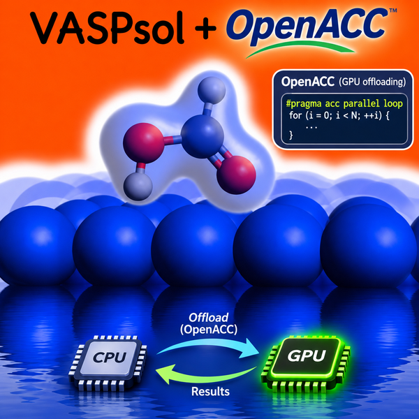

# VASPsol-openacc

Unofficial, experimental OpenACC (NVIDIA GPU) port of
[VASPsol](https://github.com/henniggroup/VASPsol), the implicit solvation
model for VASP by K. Mathew and R. G. Hennig. This fork is not affiliated
with or endorsed by the original authors. The original README follows below.

## What changed

- `src/solvation.F` offloads the solvation grid work (cavity and dielectric
  function, generalized Poisson conjugate-gradient solver, dielectric and
  cavitation potentials, ionic force correction, RHOB/RHOION output) to the
  GPU with OpenACC. Work arrays stay on the device; only scalar reductions,
  the vacuum-level search and file output are copied to the host.
- In CPU builds every directive is inactive and the original VASPsol code
  path is used.
- Global sums use `M_sum_d` (VASP >= 6.4.2), so no `mpi.F` patch is needed.
- GPU builds call the Fortran intrinsic `ERFC` instead of `ERRFC`. Parallel
  reductions change the summation order, so GPU and CPU results can differ
  at round-off level.

## Scope

- Developed for VASP 6.5.1 GPU builds with the NVIDIA HPC SDK
  (`-DACC_OFFLOAD`).
- OpenMP-offload builds (AMD/Intel GPUs) are not supported.
- The optional JDFTx interface (`-Djdftx`) runs on the host.

## Installation

1. Copy `src/solvation.F` into the `src/` directory of VASP.
2. Keep `-Dsol_compat` in `CPP_OPTIONS` of `makefile.include`.
3. Add the VASP-side hooks that VASPsol needs for your VASP version (see the
   original instructions below) and rebuild VASP.

## Status

Experimental. Compare against a CPU build of the original VASPsol before
using it for production calculations.

## Citation and license

Please cite the original VASPsol papers listed below. The code is licensed
under the Apache License 2.0 (see `LICENSE.rst`); the modifications are
marked at the top of `src/solvation.F`.

---

# Original VASPsol README


New VASPsol ++  All new development will be in VASPsol ++ https://github.com/VASPsol/VASPsol/
===============
VASPsol is a community driven code implementing implicit solvents described by 
continuum models. A new version VASPsol++, has been released.This page will be 
maintained, however, all updates to VASPsol's code will now feature
at this new repository : https://github.com/VASPsol/VASPsol/. 

**To reiterate, this page is no longer being developed further. Please go to https://github.com/VASPsol/VASPsol/**


VAPSsol ++ Paper : https://pubs.aip.org/aip/jcp/article-abstract/159/23/234117/2930317/An-implicit-electrolyte-model-for-plane-wave?redirectedFrom=fulltext

VASPsol (2014)
===============
We have implemented an implicit solvation model that describes the effect of 
electrostatics, cavitation, and dispersion on the interaction between a solute 
and solvent into the plane-wave DFT code VASP. Our implementation provides a 
computationally efficient means to calculate the effects of solvation on molecules 
and crystal surfaces as well as reaction barriers. The strength of our solvation model 
implementation is its capability to handle large periodic systems such as metal and 
semiconductor surfaces and its interoperability with standard ultrasoft pseudopotential and 
projector-augmented wave potential libraries.

Prerequisites
===============
[VASP](http://www.vasp.at/) versions 5.2.12 or 5.3.3 or 5.3.5 or >=5.4.1.

Compiler and library requirements are the same as that of VASP ([vasp wiki] (http://cms.mpi.univie.ac.at/wiki/index.php/Installing_VASP))

Installation
=============

For VASP versions = 5.2.12 or 5.3.3 or 5.3.5:
----------------------------------------------

**Note:**

- Apply the appropriate interface patch to the original VASP source code. There are 3 interface_patch files 
available in the **VASPsol/patches** folder, one for each supported versions of VASP.
```   
    cd <VASP src directory>
    patch -p1 < <path to the interface patch file>
```
- After applying the patch, copy **VASPsol/src/solvation.F** file to the VASP source directory:
- In the original VASP Makefile, put solvation.o object file name before pot.o in that order.
- ``` make clean ```
- ``` make ```

**Note:**

The file **VASPsol/src/solvation.F** combines all the modules defined in the files in the folder 
**VASPsol/src/modules** so as to conform with the new builtin interface for solvation in vasp(versions >= 5.4.1).
The files in the **VASPsol/src/modules** folder do not play any role in the installation procedure.


For VASP versions >= 5.4.1:
----------------------------

These versions of VASP support solvation calculations out of the box.
The only thing that the user needs to do is to update the solvation routines by copying 
the **VASPsol/src/solvation.F** file to the src/ folder in the original VASP folder, **vasp.5.4.X/src/** and 
follow the install instructions for the compilation of the original VASP.

**Note on versions >=5.4.4:**

It seems like the complementary error function definition has been refactored a bit in the newer versions. Inorder 
to ensure the solvation module's compatibility with the newer versions of vasp please add **-Dsol_compat** option 
to the list of precompiler options(CPP_OPTIONS) in the makefile.

**Note on binaries:**

*VASP.5.4.1 by default compiles all the three binaries: standard one(vasp_std), gamma version(vasp_gamma) and 
the one for noncollinear calculations(vasp_ncl). Some users have reported in the past that the version 5.4.1 
compilation fails after updating the solvation related files. This was due to the fact that the solvation 
modules were written and tested using the real to complex FFTs(same as vasp_std and vasp_gamma) whereas 
the non-collinear compilation uses complex to complex FFTs. The issue has been fixed and all three binaries 
will compile fine without any errors.*

**Note on running Poisson-Boltzmann solver with 5.4.1:**

*To compute the FERMI_SHIFT as mentioned in the documentation in version 5.4.1, minor modification is required
to the pot.F file. This can be done by applying the patch file pbz_patch_541 provided in the src/patches folder
as follows.*
```   
    cd vasp.5.4.1
    patch src/pot.F < <path to the pbz_patch_541 patch file>
```
For VASP6 versions >= 6.1.0:
----------------------------
For VASP versions > 6.1.0 there is currently a patch in /VASPsol/patches/VASPsol6.patch. This patch applies the FERMI_SHIFT patch to the pot.F as well as providing additional subroutines. This patch was developed by user shk11 in Issue #43. 

- copy solvation.F from path_to_VASPsol/src/solvation.F to path_to_VASP6_install/src/
- Navigate to path_to_VASP6_install/src/ and modify the .objects file by ensuring that “solvation.o” appears before “pot.o”
- Set the CPP option "-Dsol_compat" in the VASP makefile.include file. 
- Compile the code as described in the instructions on the VASP wiki.

```   
    cd vasp.6.1.0
    patch -p0 < <path to the pbz_patch_610 patch file>
```

Usage
======
Please see the file USAGE.md in the docs folder for instructions and the examples folder for some sample calculations.


License
=========
VASPSol is released under the terms of Apache version 2.0 license:

Copyright 2013-2015 Kiran Mathew and Richard Hennig

Licensed under the Apache License, Version 2.0 (the "License");
you may not use this file except in compliance with the License.
You may obtain a copy of the License at

    http://www.apache.org/licenses/LICENSE-2.0

Unless required by applicable law or agreed to in writing, software
distributed under the License is distributed on an "AS IS" BASIS,
WITHOUT WARRANTIES OR CONDITIONS OF ANY KIND, either express or implied.
See the License for the specific language governing permissions and
limitations under the License.

For discussions and feedback
=============================
Join our mailing list: https://groups.google.com/forum/#!forum/vaspsol

Contributing
=============
Please contact Dr. Richard Hennig (rhennig[at]mse.ufl.edu)

Authors
========
Kiran Mathew

Dr. Richard Hennig


How to cite
===========

DOI for the VASPsol Github repository:

[](https://doi.org/10.5281/zenodo.2555053)


If you use the VASPsol package in your research, please cite the following papers:

- Implicit solvation model for density-functional study of nanocrystal surfaces and reaction pathways.
 K. Mathew, R. Sundararaman, K. Letchworth-Weaver, T. A. Arias, and R. G. Hennig, J. Chem. Phys. 140, 084106 (2014), [doi:10.1063/1.4865107] (https://doi.org/10.1063/1.4865107).

- Implicit self-consistent electrolyte model in plane-wave density-functional theory.
 K. Mathew, V. S. C. Kolluru, S. Mula, S. N. Steinmann, and R. G. Hennig, J. Chem. Phys. 151, 234101 (2019), [doi:10.1063/1.5132354]
 (https://doi.org/10.1063/1.5132354).

BibTex entry for the Github repository and the publications::

```
   @misc{VASPsol-Software,
     title        = {VASPsol: Implicit solvation and electrolyte model for density-functional theory},
     author       = {K. Mathew and V. S. Chaitanya Kolluru and R. G. Hennig},
     year         = 2018,
     publisher    = {GitHub},
     journal      = {GitHub repository},
     howpublished = {\url{https://github.com/henniggroup/VASPsol}},
     url          = {https://github.com/henniggroup/VASPsol},
     doi          = {10.5281/zenodo.2555053}
   }
   
   @article{VASPsol2014-Dielectric,
     title        = {Implicit solvation model for density-functional study of nanocrystal surfaces
                     and reaction pathways.},
     author       = {K. Mathew and R. Sundararaman and K. Letchworth-Weaver and T. A. Arias and
                     R. G. Hennig},
     year         = 2014,
     journal      = {J. Chem. Phys.},
     volume       = 140,
     pages        = {084106},
     doi          = {10.1063/1.4865107}
   }
   
   @article{VASPsol2019-Electrolyte,
     title        = {Implicit self-consistent electrolyte model in plane-wave density-functional theory.},
     author       = {K. Mathew and V. S. C. Kolluru and S. Mula and S. N. Steinmann and R. G. Hennig},
     year         = 2019,
     journal      = {J. Chem. Phys.},
     volume       = 151,
     pages        = {234101},
     doi          = {10.1063/1.5132354}
   }
```
